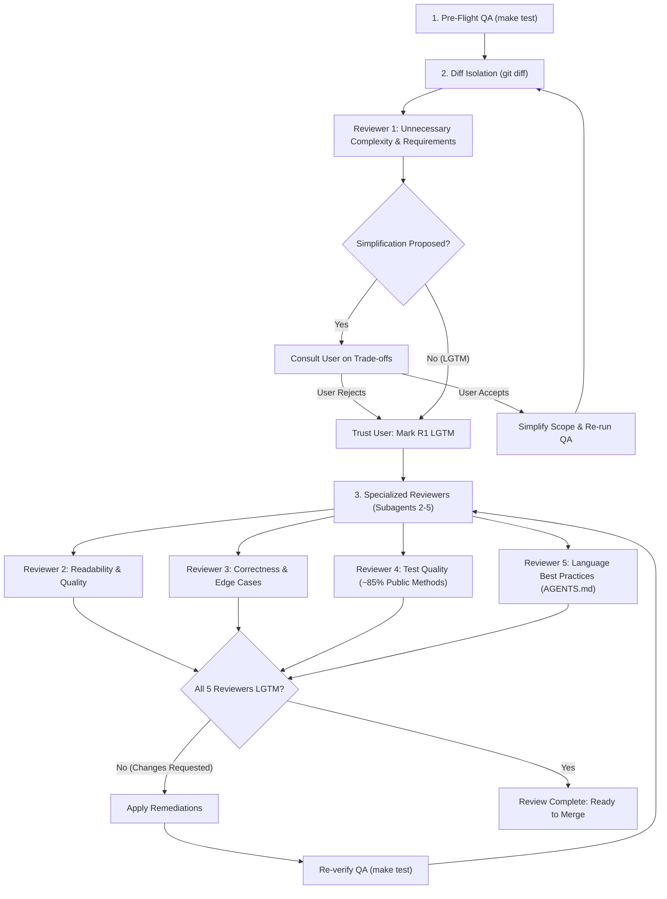

# Multi-Agent Code Review

A rigorous, specialized code review pipeline executed **after QA has passed**. Five dedicated subagents inspect the changes from distinct angles to enforce simplicity, readability, correctness, pragmatic testing, and persistent repository best practices.

The review operates as a convergence loop: subagents inspect, report findings, remediation occurs, QA is re-verified, and the loop repeats until **all five reviewers declare `LGTM`**.



---

## Prerequisites (Non-Negotiable)

1. **QA Must Pass First**:
   - Code review is **never** performed on unverified or broken code.
   - Run the project test suite using the `qa` skill before initiating review:
     ```bash
     make test
     ```
   - If tests fail, halt immediately. Fix all issues and achieve a green test suite before invoking this skill.

2. **Diff Isolation**:
   - Determine the exact scope of changes being reviewed:
     ```bash
     # Uncommitted or staged changes
     git diff HEAD
     # Or against target base branch
     git diff main...HEAD
     ```

---

## The 5 Review Categories & Roles

Every category is reviewed by an independent subagent with a dedicated prompt and single responsibility.

### 1. Unnecessary Complexity (`reviewer-complexity`)
- **Core Question**: *Can we alter or relax the user requirements to vastly simplify the implementation?*
- **Checklist**:
  - Does the solution over-engineer for hypothetical futures (violating YAGNI)?
  - Would a slight shift in interface or requirements cut the code footprint in half?
  - What are the concrete user-facing trade-offs if requirements are relaxed?
- **Golden Rule — User Sovereignty**:
  > [!IMPORTANT]
  > **The user may reject feedback from the first agent. Trust them.**
  > If the user decides not to simplify or change requirements, immediately accept their decision and mark this dimension as `LGTM (Requirements confirmed by user)`. Do not argue or re-litigate.

### 2. Code Readability and Quality (`reviewer-readability`)
- **Core Question**: *Is the code clean, self-documenting, and structurally simple?*
- **Checklist**:
  - Are function, variable, and type names expressive and self-documenting (no cryptic abbreviations)?
  - Are complex loops, nested conditions, or long routines extracted into focused, single-purpose helper functions?
  - Are cyclomatic complexity and data coupling minimized?
  - Is dead code, obsolete comments, and leftover debugging cruft eradicated?

### 3. Code Correctness (`reviewer-correctness`)
- **Core Question**: *Does the code do exactly what it should do, and are all edge cases covered?*
- **Checklist**:
  - Does logic hold across boundary conditions (0, 1, empty collections, `None`/`nil`/`null`, EOF, maximum sizes)?
  - Are off-by-one errors, state mutation side effects, or resource leaks (unclosed files, lingering connections) present?
  - Are errors handled gracefully and propagated without swallowing diagnostic context?
  - In concurrent or async code, are race conditions or deadlocks possible?

### 4. Test Quality and Coverage (`reviewer-tests`)
- **Core Question**: *Are tests high-value, resilient, and exercising public interfaces to ~85% coverage?*
- **Checklist**:
  - Target coverage is approximately **85%**, focused strictly on **public methods and API contracts**.
  - **Zero Over-Abstraction**: Do **not** introduce complex abstractions, mock factories, or architectural gymnastics just to reach that last bit of coverage.
  - **Meaningful over Exhaustive**: A few robust, high-signal tests exercising real usage are vastly preferred over hundreds of brittle, implementation-coupled tests.
  - Tests must verify behavior and invariants, not private implementation details.

### 5. Best Practices & AGENTS.md Sync (`reviewer-best-practices`)
- **Core Question**: *Does the code follow idiomatic language patterns, and are new practices captured in `AGENTS.md`?*
- **Checklist**:
  - Check the project's [AGENTS.md](file:///home/charles/p/agy-template/AGENTS.md) for existing directives and conventions.
  - Identify language-specific idioms (e.g., Python PEP 8, Go error handling, Rust ownership/borrowing patterns).
  - **Collaborate with the User**: If conventions for the stack are not yet established or a new design pattern is introduced, discuss it with the user.
  - **Document & Reference**: Update `AGENTS.md` under `## Language Best Practices & Conventions` with agreed-upon rules, and reference them in the review verdict.

---

## Execution Workflow

### Step 1: Pre-Flight Verification
Run `make test`. Ensure exit code `0`. If failing, resolve test failures before proceeding.

### Step 2: Extract Changes
Gather the git diff and summary of changed files:
```bash
git status --short
git diff --stat main...HEAD
git diff main...HEAD
```

### Step 3: Phase 1 — Scope & Complexity Review (Sequential)
Launch Reviewer 1 first. If requirements can be simplified, revising them early prevents wasted review and refactoring effort on code that may be discarded.

**Subagent Prompt Template (Reviewer 1)**:
```text
Role: Reviewer 1 - Complexity & Scope Simplification
Context: You are reviewing the following git diff after QA has passed.
Diff:
<GIT_DIFF>

Task:
Analyze whether the implementation contains unnecessary complexity.
Specifically: Can we alter or relax user requirements to vastly simplify the code?
If yes:
1. Explain the proposed simplification.
2. Outline the exact implementation complexity eliminated.
3. Clearly detail the trade-offs the user would make.
Status: If simplifications exist, output `PROPOSAL: <details>`. If already minimal and optimal, output `LGTM: <reason>`.
```

- If `PROPOSAL` is returned:
  - Present the proposal and trade-offs to the user.
  - If the user **accepts**: Adjust requirements, update implementation, run `make test`, and restart review.
  - If the user **rejects**: **Trust them**. Record `LGTM (User confirmed requirements)` and advance immediately to Phase 2.

### Step 4: Phase 2 — Parallel Deep Review (Reviewers 2 through 5)
Dispatch Reviewers 2, 3, 4, and 5 concurrently via `invoke_subagent`.

**Subagent Prompt Template (Reviewer 2 - Readability & Quality)**:
```text
Role: Reviewer 2 - Code Readability and Quality
Diff:
<GIT_DIFF>

Inspect the changes for:
- Self-documenting naming (functions, variables, types).
- Complex loops or nested logic that should be extracted into small helper functions.
- Low cyclomatic and data complexity.
- Unix philosophy: modularity, clean interfaces, no bloat.

Output either:
- `CHANGES_REQUESTED`: Bullet list of specific improvements with file paths and line numbers.
- `LGTM`: Brief summary of why readability and quality are sound.
```

**Subagent Prompt Template (Reviewer 3 - Correctness)**:
```text
Role: Reviewer 3 - Code Correctness & Edge Cases
Diff:
<GIT_DIFF>

Inspect the changes for:
- Correctness: Does the code fulfill its contract under all conditions?
- Boundary conditions: 0, 1, empty collections, null/None, max values.
- Error handling, resource management, and concurrency safety.

Output either:
- `CHANGES_REQUESTED`: Actionable bug descriptions and edge case scenarios with file paths and line numbers.
- `LGTM`: Brief confirmation of correctness and edge case coverage.
```

**Subagent Prompt Template (Reviewer 4 - Test Quality & Coverage)**:
```text
Role: Reviewer 4 - Test Quality and Coverage
Diff:
<GIT_DIFF>

Evaluate test quality against these criteria:
- Target: ~85% coverage exercising public methods and interfaces.
- Anti-pattern: Do NOT introduce complex abstractions or mock frameworks just to get extra coverage.
- Principle: Fewer, meaningful tests > exhaustive, brittle tests.
- Verify tests actually assert behavior rather than simply running code.

Output either:
- `CHANGES_REQUESTED`: Specific high-value tests needed on public interfaces.
- `LGTM`: Confirmation that tests are meaningful, non-overengineered, and sufficiently cover public APIs.
```

**Subagent Prompt Template (Reviewer 5 - Best Practices & AGENTS.md)**:
```text
Role: Reviewer 5 - Language Best Practices
Diff:
<GIT_DIFF>
Current AGENTS.md:
<AGENTS_MD_CONTENT>

Inspect the changes for:
- Language idiomatic patterns and conventions.
- Compliance with existing rules in AGENTS.md.
- Identify any new patterns that should be documented.

Output either:
- `CHANGES_REQUESTED`: Deviations from idioms or suggestions for AGENTS.md additions.
- `LGTM`: Confirmation of adherence to idioms and AGENTS.md conventions.
```

### Step 5: Triage, Remediation & AGENTS.md Sync
1. **Best Practices Sync**:
   - If Reviewer 5 suggests new project conventions, discuss them with the user.
   - Upon agreement, append or update the conventions under `## Language Best Practices & Conventions` in [AGENTS.md](file:///home/charles/p/agy-template/AGENTS.md).
2. **Apply Remediations**:
   - Refactor code for approved readability and correctness findings.
   - Add high-value public-interface tests if requested by Reviewer 4.
3. **Re-verify QA**:
   - Execute `make test`. Fix any regressions immediately.

### Step 6: Loop Until Full Convergence
- Re-run the review on updated diffs for any reviewer that previously requested changes.
- Repeat until **all 5 reviewers issue `LGTM`**.
- Present a final review summary table to the user.

---

## Convergence Summary Format

When all reviewers reach consensus, summarize the results:

| Reviewer | Category | Verdict | Notes |
| :--- | :--- | :---: | :--- |
| **1. Complexity** | Scope & Requirements | `LGTM` | Minimal implementation / User confirmed requirements |
| **2. Readability** | Quality & Naming | `LGTM` | Clean functions, low cyclomatic complexity |
| **3. Correctness** | Logic & Edge Cases | `LGTM` | Boundaries verified, error paths handled |
| **4. Tests** | ~85% Public Methods | `LGTM` | High-value public tests, zero abstraction bloat |
| **5. Best Practices**| Language Idioms & AGENTS.md | `LGTM` | Idiomatic; conventions synchronized to AGENTS.md |
